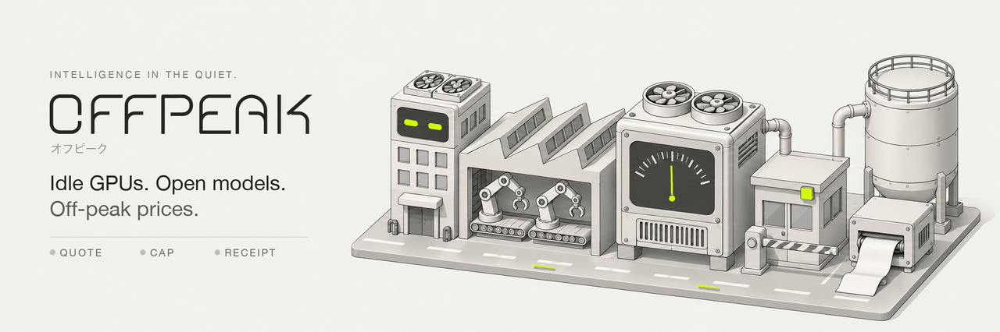
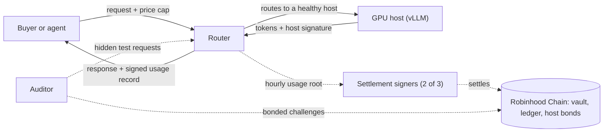

<p align="center">
  
</p>

<p align="center">
  <strong>An OpenAI-compatible endpoint for open-weight models, served from bonded GPU hosts.</strong><br>
  Priced by the hour and by live load. Settled in USDG. Every response carries a signed usage record.
</p>

<p align="center">
  
  
  
  
  <a href="LICENSE"></a>
</p>

<p align="center">
  <a href="#how-it-works">How it works</a> ·
  <a href="#what-is-in-it">What is in it</a> ·
  <a href="#calling-it">Calling it</a> ·
  <a href="#run-it-locally">Run it locally</a> ·
  <a href="#deploy-it">Deploy it</a> ·
  <a href="#repository-map">Repository map</a> ·
  <a href="#limits">Limits</a> ·
  <a href="#license">License</a>
</p>

> [!IMPORTANT]
> **P1 is live on Robinhood Chain mainnet (chain 4663).** The vault, host registry, usage ledger, audit court and fee splitter are deployed and owned by a timelock, with a 500 USDG per-buyer beta deposit cap. Addresses are in [`packages/abis/deployments/4663.json`](packages/abis/deployments/4663.json); the vault is [`0x696C1Bb94522924deBAB672936AfEb59a532a8D3`](https://robinhoodchain.blockscout.com/address/0x696C1Bb94522924deBAB672936AfEb59a532a8D3). No host is serving yet, so paid inference starts once the first hosts finish their 72-hour probation. P2 and P3 contracts are not deployed. The contracts have had internal reviews but no external audit, which comes before the cap lifts. Launch status lives in [`docs/launch/`](docs/launch/).

## Why

GPUs sit idle between peaks. Offpeak gives that spare time a market.

Hosts post a price for every hour of the week. The router measures load itself and moves the live price between 0.4× and 1.2× of that base, so a quiet hour costs less. Buyers prepay USDG into a vault they can withdraw from, or an agent pays per call with no account at all. Text work that can wait can run as a night job, with the price locked up front.

## How it works



1. **Fund it.** Deposit USDG into the vault, or open a payment channel. An unpaid agent gets `402 Payment Required`, listing a channel first and x402 `upto` second.
2. **Set a cap.** `X-Offpeak-Max-Price` says the most you will pay. Interactive requests over it fail with `429` instead of charging more.
3. **Get served.** The router holds the maximum cost, routes to a healthy host, and fails over once if that host fails before the first token.
4. **Keep the receipt.** The router and the host count tokens separately and both sign a usage record covering the counts, prices, model digest, and prompt and output hashes.
5. **Settle.** Each hour, three signers recompute the totals, two must agree, and a Merkle root goes on-chain so any record can be proven.
6. **Check it.** You can recount your own requests and dispute any of them within 7 days. Hosts post bonds and are audited for model swaps.

## What is in it

| Feature | What it does | Phase |
| --- | --- | --- |
| OpenAI-compatible API | Chat with streaming, tools and JSON mode, plus embeddings, batches and models | P1 |
| Off-peak pricing | 168-hour host price sheets × router-measured load | P1 |
| Price caps | `X-Offpeak-Max-Price`, with `429 price_above_cap` over the limit | P1 |
| Prepaid vault | A USDG balance with withdraw-all inside 2 hours | P1 |
| Signed usage records | Router and host signatures, with hourly Merkle roots | P1 |
| Disputes | Automatic token recount, signature and price checks within 7 days | P1 |
| Host bonds and audits | 2,000 USDG minimum bond, 72-hour probation, statistical swap audits, and a human panel before any 100% slash | P1 |
| Night jobs | `X-Offpeak-Flex` or `/v1/batches`, with the price locked up front | P2 |
| Agent payments | Payment channels, x402 `upto` and `exact` | P2 |
| MCP tools | `offpeak_complete`, `offpeak_prices`, `offpeak_schedule_job`, `offpeak_usage` | P2 |
| Windows | Tradable reservations of future capacity | P3 |
| Sealed tier | TDX and GPU attestation with client-side encryption | P3 |

Phases are the roadmap, not a statement of what is live. See the note at the top of this page.

## Calling it

Point any OpenAI-style client at Offpeak and add a cap:

```http
POST /v1/chat/completions
Authorization: Bearer op_live_…
X-Offpeak-Max-Price: in=0.15,out=0.60
```

Or use the TypeScript SDK, which can verify the signed record for you:

```ts
import { Offpeak } from "@offpeak/sdk"

const op = new Offpeak({ baseURL: "https://api.example", apiKey: "op_live_...", deployment: "local" })

const result = await op.chat({ model: "ofm-8b", messages: [{ role: "user", content: "hello" }], max_tokens: 64 })
const report = await op.verifyUsage(result.envelope)

console.log(result.text, report.ok)
```

The full surface is in [`docs/api.md`](docs/api.md), and agents can use the [MCP tools](packages/mcp/README.md).

## Run it locally

You need [Bun](https://bun.sh), [Foundry](https://getfoundry.sh) and [Redis](https://redis.io). Local runs use mock services, an in-process database and a mock GPU engine, so no GPU is required.

```bash
git clone --recurse-submodules https://github.com/OffPeakAI/offpeak.git
cd offpeak
bun install --frozen-lockfile --ignore-scripts
```

Build the contracts and run their tests:

```bash
bun run contracts:build
bun run contracts:test
```

Start Redis on its default port, then run the TypeScript suite. Leave `.env` out for this step, because the tests set their own environment and some start real services:

```bash
redis-server --save "" --appendonly no
bun run test:b
```

To run the services yourself, copy the placeholders and fill in the keys each service needs:

```bash
cp .env.example .env
```

| Command | What it does |
| --- | --- |
| `bun run chain:local` | Local chain with the contracts deployed |
| `bun run router:dev` | The OpenAI-compatible router |
| `bun run web:dev` | The dashboard |
| `bun run host:dev` | The host agent |
| `bun run contracts:invariant` | Solidity invariant suites |
| `bun run test:integration` | Integration tests across the services |
| `bun run lint:claims` | Checks user-facing copy against the product rules |

`.env.example` holds placeholders only. Never commit real keys.

## Deploy it

Nothing is deployed yet, so these are the steps a launch will follow, not a record of one. The runbooks are the full version, and they win if this page disagrees.

Start from a fresh clone, then build and test before anything else:

```bash
git clone --recurse-submodules https://github.com/OffPeakAI/offpeak.git
cd offpeak
bun install --frozen-lockfile --ignore-scripts
bun run contracts:build
bun run contracts:test
```

### The contracts

The full steps are in [`docs/runbooks/deploy-mainnet.md`](docs/runbooks/deploy-mainnet.md). In short:

1. Create the three Safes and one key per role, and set the treasury and ops wallets.
2. Fill in `contracts/config/chains/4663.json`, and check the USDG address against the issuer's published list.
3. Fund a fresh deployer key with a little ETH, then set `OFFPEAK_RPC_URL` and `DEPLOYER_KEY`.
4. Rehearse on a fork. Neither command touches the real config or deployment files:

```bash
bun run contracts:fork
bun run deploy:rehearse
```

5. Deploy, hand ownership to the timelock, and check the wiring. `VerifyWiring` sends nothing and reverts naming the first check that fails:

```bash
cd contracts
forge script script/Deploy.s.sol --rpc-url "$OFFPEAK_RPC_URL" --private-key "$DEPLOYER_KEY" --broadcast
forge script script/HandOffOwnership.s.sol --rpc-url "$OFFPEAK_RPC_URL" --private-key "$DEPLOYER_KEY" --broadcast
forge script script/VerifyWiring.s.sol --rpc-url "$OFFPEAK_RPC_URL"
```

6. Discard the deployer key, commit `packages/abis/deployments/4663.json`, and fund the protocol reserve with `fundReserve`.

P2 and P3 contracts each wait for their own external audit, and go through the timelock.

### A host

The full steps are in [`docs/runbooks/deploy-host.md`](docs/runbooks/deploy-host.md). A host needs a GPU machine with Docker and the NVIDIA runtime, and a TLS proxy of its own in front of the agent.

1. Copy `deploy/host/host.example.yaml` to `/etc/offpeak/host.yaml` and fill in your operator and `https://` endpoint.
2. Run `offpeak-host init`, which creates the data folders and writes the vLLM arguments. The CLI is `apps/host-agent/src/cli.ts`, so `bun run` it from a clone.
3. Start vLLM and the agent with the env file `init` wrote:

```bash
docker compose -f deploy/host/compose.yaml --env-file /var/lib/offpeak/vllm-<model>.env up -d
```

4. Run `offpeak-host verify`, then `offpeak-host register --send` to post your bond, and `offpeak-host price-sheet set --file <sheet.json>` to publish your prices.

## Repository map

| Path | What lives there |
| --- | --- |
| [`contracts/`](contracts/) | Vault, usage ledger, host registry, audit court, channels, x402 escrow, Windows, fee splitter |
| [`apps/router/`](apps/router/) | OpenAI-compatible API, routing, pricing, metering, payments, disputes |
| [`apps/host-agent/`](apps/host-agent/) | Runs beside vLLM, verifies model files, meters and signs usage |
| [`apps/auditor/`](apps/auditor/) | Canaries, likelihood audits, sequential tests, challenge filing |
| [`apps/scheduler/`](apps/scheduler/) | Night jobs and price forecasts |
| [`apps/web/`](apps/web/) | Dashboard and public price page |
| [`services/`](services/) | Indexer, settlement signers, facilitator, keepers, rulings |
| [`packages/`](packages/) | [SDK](packages/sdk/README.md), [MCP tools](packages/mcp/README.md), shared types, ABIs, audit tests |
| [`deploy/`](deploy/) | Host containers and model manifests |
| [`docs/`](docs/) | API reference, limits, runbooks, launch gates and security reviews |
| [`website/`](website/) | The public site, with the [whitepaper](website/docs-md/WHITEPAPER.md) and [roadmap](website/docs-md/ROADMAP.md) |

## Limits

- Open-weight models only. Open models trail frontier models on the hardest tasks.
- Prices move. The live price at the start of a request is what you pay.
- Discounts depend on host supply and idle time. With few hosts, discounts are smaller.
- Open hosts and Offpeak's router can read prompts unless you use the sealed tier, which is not switched on yet.
- Audits are statistical. They catch sustained model swaps, not every response.
- Your balance is prepaid credit for Offpeak, not a bank deposit and not e-money.
- USDG can be frozen by its issuer. Permit2 is a shared dependency.
- During the beta, deposits are capped at 500 USDG per buyer until the external contract audit is complete.
- Holding $OFPK alone earns nothing. Token hooks are not switched on yet.

The full list is in [`docs/limits.md`](docs/limits.md). Internal review findings are in [`docs/launch/security-review.md`](docs/launch/security-review.md).

## License

Source-available under the [PolyForm Noncommercial License 1.0.0](LICENSE). You can read, run, change and share this code for any noncommercial purpose. Commercial use is not licensed, so please [get in touch](https://x.com/UseOffPeak) if you need it. This is not an open-source license in the OSI sense.

Third-party components keep their own licenses, including the tokenizer fixtures in `packages/shared/fixtures/tokenizers/` and the vendored files under `website/`. Models served through Offpeak are licensed by their authors.

<sub>Third-party names describe compatibility only; no affiliation.</sub>
