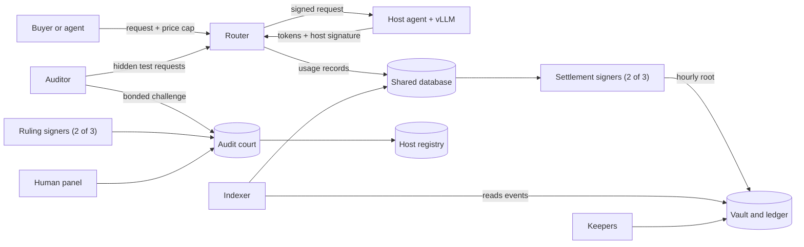

# Architecture

Offpeak is an OpenAI-compatible endpoint served by bonded GPU hosts, and paid for in USDG on Robinhood Chain (4663). Inference runs off chain. Money, bonds and hourly usage roots live on chain. Nothing here is on mainnet yet, so the holders below are the plan in `docs/runbooks/deploy-mainnet.md`, not a record of a deployment.

## Components

### On chain

| Contract | Phase | What it does |
|---|---|---|
| `OffpeakVault` | P1 | Holds buyer balances, the settlement pool and the protocol reserve. Takes hourly batches, refunds, deposits and exits |
| `UsageLedger` | P1 | Stores each hour's usage root, and knows the router's signing address |
| `HostRegistry` | P1 | Holds bonds and host credits, and tracks probation, freezes, challenges, delisting and exit |
| `AuditCourt` | P1 | Runs challenges, rulings, appeals and the panel, and pays refund trees |
| `FeeSplitter` | P1 | Splits fees between the host rewards pool, the ops wallet and the treasury |
| `ChannelManager` | P2 | Payment channels for agents, paid by vouchers |
| `X402Escrow` | P2 | x402 `upto` and `exact` payments |
| `WindowMarket` | P3 | Tradable reservations of future capacity |
| `OfpkHooks` | P3 | Token tiers and bonuses. Token hooks are not switched on yet |

Nothing is upgradeable. Contracts join through `setPeers`, and each peer slot can be set once.

### Off chain

| Component | What it does |
|---|---|
| `apps/router` | The OpenAI-compatible API. Prices, routes, meters, signs usage records and answers disputes |
| `apps/host-agent` | Runs beside vLLM. Verifies model files, counts tokens on its own and signs usage |
| `apps/auditor` | Sends canaries, scores responses and files challenges |
| `apps/scheduler` | Night jobs and price forecasts |
| `services/settlement` | Three signers that rebuild each hour's batch. Two must agree before it lands |
| `services/rulings` | Three ruling signers, plus the packet the human panel reviews |
| `services/indexer` | Turns chain events into the `chain` schema that the router and signers read |
| `services/facilitator` | Verifies x402 payments, then relays and captures them |
| `services/keepers` | Timed jobs: exits, channel claims, escrow expiry, challenge finalizing, fee distribution and gas watching |
| `packages/sdk`, `packages/mcp` | Client SDK and MCP tools, which run on the buyer's side |

Hours settle in order, one batch per hour. Each batch carries a Merkle root, so any record can be proven against it.

## Actors and roles

Every owner function sits behind a `TimelockController` with a 48 hour delay. After `HandOffOwnership` the `multisig` Safe holds the proposer, executor and canceller roles, the timelock has no admin, and the deployer key holds nothing.

### Privileged functions

| Role | Holder | Functions | How it changes |
|---|---|---|---|
| Owner | Timelock, 48 hours, driven by the `multisig` Safe (2 of 3) | `OffpeakVault`: `setPeers`, `setSettlers`, `setGuardian`, `disableBetaCap`. `UsageLedger`: `setVault`, `setRouterSigner`. `HostRegistry`: `setPeers`, `setGpuClass`. `AuditCourt`: `proposeSigners`. `FeeSplitter`: `setPeers`, `setTokenHooksEnabled`, `setSwapAdapter`, `setBurnKeeper`. `OfpkHooks`: `setTiers`, `setBonusPerOfpk`. `WindowMarket`: `setEarlyAccessSeconds` | Multisig queues it, and it runs after 48 hours |
| Guardian | `guardian` Safe (2 of 3), separate people from the multisig | `OffpeakVault`: `setUsagePaused`, `setSettlesPaused`. `HostRegistry`: `clawBack`, for credits still inside their 24 hour hold | `setGuardian` on the vault. The registry's guardian is set at deploy and has no setter |
| Settlers | Three keys on separate machines, 2 of 3 | Sign for `OffpeakVault.settle`, `OffpeakVault.refund`, `FeeSplitter.distributeRewards` and `WindowMarket.postPerformance` | `setSettlers`, 48 hours |
| Rulers | Three keys on separate machines, 2 of 3 | Sign for `AuditCourt.postRuling` | `proposeSigners`, 48 hours, then `applySigners` 8 days later |
| Panel | `panel` Safe, at least 3 of 5 human reviewers who hold no other Offpeak key | Signs for `AuditCourt.postPanelDecision`. Any 100% slash needs its Confirm | `proposeSigners`, as above |
| Router signer | One key, held by the router | Signs usage records and hour closes. `UsageLedger.routerSigner` holds its address | `setRouterSigner`, 48 hours |
| Channel payee | One key, held by the router, and not the router signer's | `ChannelManager.settleChannel`, and the router's signature on `cooperativeClose` | Immutable. Rotating it means redeploying `ChannelManager` |
| Relay | One key, held by the facilitator | `X402Escrow.authorizeBatch`, `settleExact` | Immutable |
| Capturer | One key, held by the facilitator | `X402Escrow.capture`, `captureBatch` | Immutable |
| Keeper | One key, held by the keepers | `ChannelManager.settleChannel` | Immutable |
| Burn keeper | Unset until the legal gate passes | `FeeSplitter.executeBurn` | `setBurnKeeper`, 48 hours |

`treasury` and `opsWallet` receive fees and are set at deploy. Neither has a privileged function. A signer change on `AuditCourt` takes 8 days on top of the timelock, longer than the 7 day host unbonding, so a host can leave before new signers take effect.

### Everyone else

| Actor | What they can do | What they rely on |
|---|---|---|
| Buyer | Deposit, set caps, withdraw the unreserved part at once, withdraw all within 2 hours, recount and dispute within 7 days | The router within the request hour, and hosts to run the model they claim |
| Agent | Pay by channel or x402 with no account | The router to count fairly, with their own signed limits as the ceiling |
| Host | Bond, post price sheets, sign usage, respond to challenges, exit after 7 days of unbonding | The router to route and report fairly, and rulers and the panel to rule fairly |
| Auditor | File a bonded challenge, as anyone can. It holds no privileged role | Hosts not spotting its canaries |
| Anyone | Call `executeWithdrawAll` when due, `finalize`, `applySigners` when due, and `fundReserve` | Nothing |

## Trust assumptions

- **The router is trusted within the request hour.** It meters, prices and reports what happened. A buyer can check a signed record and dispute it within 7 days, but cannot stop a wrong count in the hour it happens. Caps and the 2 hour exit limit the damage. A router can also under-report a cut stream, because the host signs a partial record it cannot fully check.
- **Audits are statistical.** They catch sustained model swaps, not every response. Real calibration on GPUs has not run. Swap detection has only run on simulated scores, so its thresholds are not proven on real hardware.
- **Open hosts and the router can read prompts** unless a buyer uses the sealed tier, which is not switched on yet.
- **Two of three settlers can sign a batch.** The vault checks caps, totals and hour order, but it does not recompute usage. Two settlers can understate a buyer's `lastTs` inside the request hour. The design relies on the three signers being separate people and machines, each with its own RPC provider.
- **Two of three rulers can post a ruling.** They can take at most two Breach slashes from a host, and a full slash always needs the panel.
- **The multisig can change most roles, with a 48 hour delay.** Buyers can leave inside 2 hours, so that delay is enough for them. No owner function moves buyer balances, bonds or stray USDG. Its route to them is replacing signers, which takes 48 hours for settlers and 8 days more for rulers and the panel.
- **The guardian can pause and claw back without a delay.** A pause does not stop withdrawals or withdraw-all. `setUsagePaused` works because the router obeys it, not because the contracts refuse usage. `clawBack` reaches only credits inside their 24 hour hold.
- **Operators run the off-chain services.** Keys, databases and the internal token are only as safe as the machines that hold them. Internal reviews have run, and an external audit has not.

The accepted risks are in [`SECURITY.md`](../SECURITY.md), and the buyer-facing version of these limits is in [`limits.md`](limits.md).

## External dependencies

| Dependency | Used for | What happens if it fails |
|---|---|---|
| Robinhood Chain (4663) | All settlement and bonds | Settlement waits, then catches up in order. See `docs/runbooks/rpc-outage.md` |
| USDG | Balances, bonds, fees | Upgradeable and pausable, and its issuer can freeze addresses. Offpeak has no way around that. See `docs/runbooks/usdg-freeze.md` |
| Permit2 | Signed deposits, channels and x402 | A shared dependency, checked by code hash at deploy |
| Safe | Multisig, guardian and panel | Owner actions and pauses wait until it works |
| OpenZeppelin Contracts 5.4.0 | Ownership, timelock, tokens, signatures | Pinned exactly in `package.json` |
| RPC providers | Every chain read and write | Each signer has its own, so one outage stops one signer |
| Postgres and Redis | Shared state, queues and live events | Services that need them stall until they are back |
| vLLM and model files | Inference | Pinned by image digest and model manifest. A host that fails its checks does not boot |
| TDX and GPU attestation services | Sealed tier, P3 | Not switched on yet |
